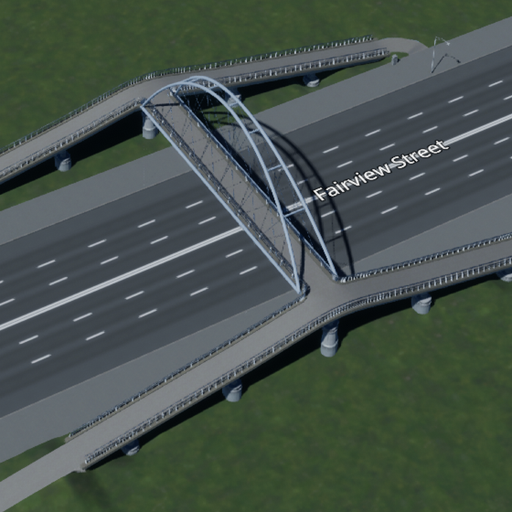
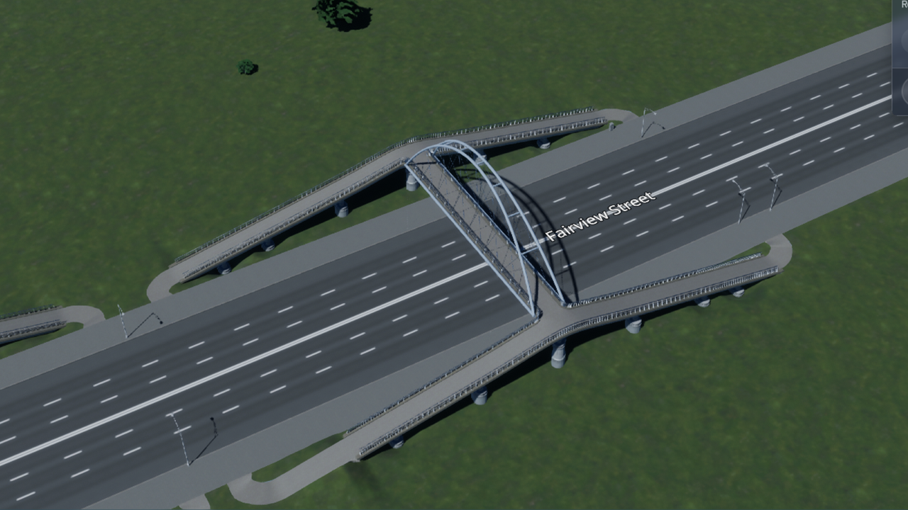
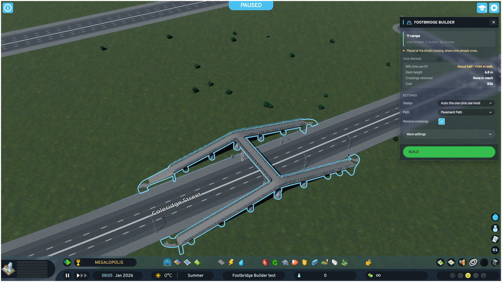
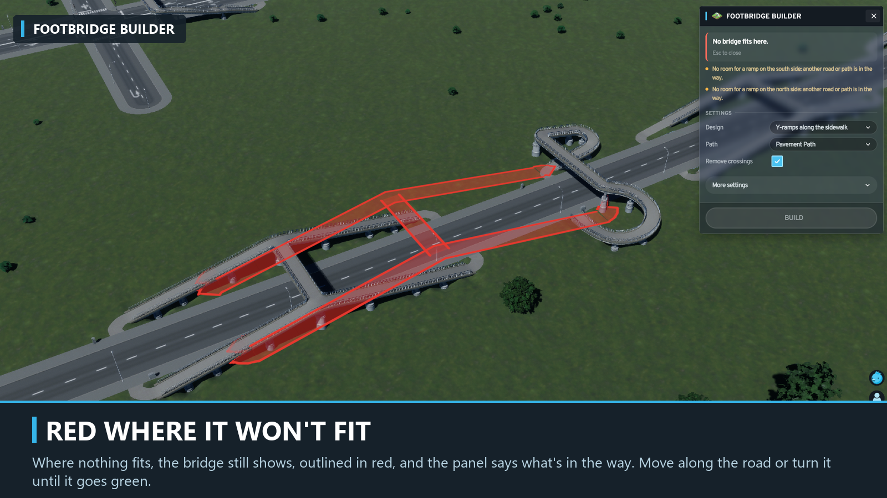
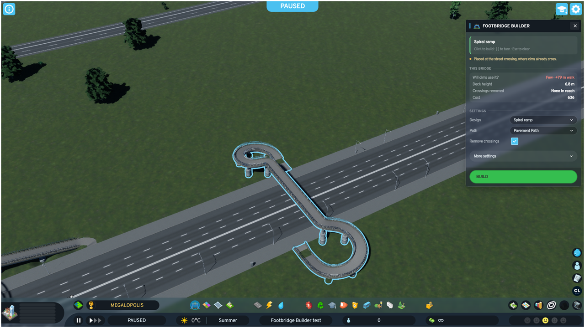
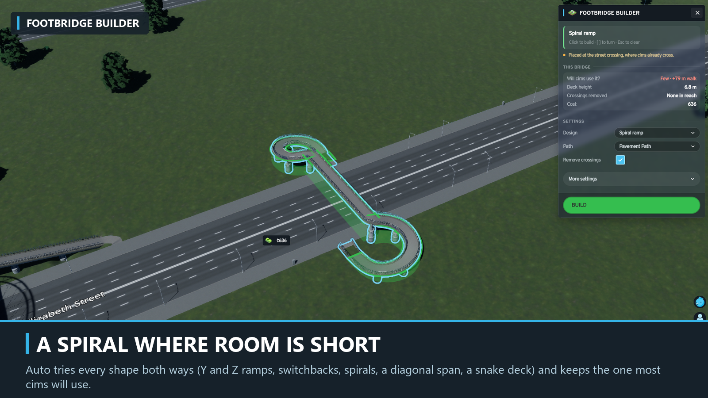
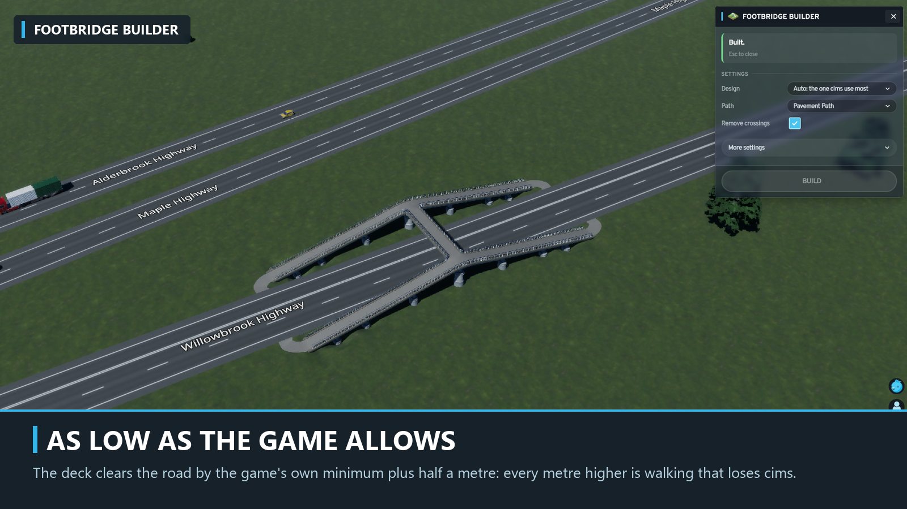
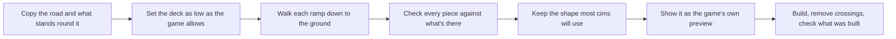

# Footbridge Builder



<a href="https://mods.paradoxplaza.com/authors/TevBenji/cities_skylines_2"></a>


<a href="LICENSE"></a>

A Cities: Skylines II mod that plans a working pedestrian bridge over the road you point at, and builds it when you say so.

Building a footbridge by hand takes three mods and a lot of fiddling, and then the cims cross at street level anyway.
**Footbridge Builder does it for you.** Hover a road and the bridge appears, as low as the game allows, with ramps that fit
beside the road and feet that join the sidewalk. A green outline means it fits. Click to pin it, adjust it in the panel,
and press **Build**. Hover the middle of a junction or roundabout instead, and one bridge goes round it, over every road
there.

<a href="#features">Features</a> ·
<a href="#how-to-use">How to use</a> ·
<a href="#settings">Settings</a> ·
<a href="#will-cims-use-it">Will cims use it?</a> ·
<a href="#how-it-works">How it works</a> ·
<a href="#found-a-bug">Found a bug?</a> ·
<a href="#building-from-source">Building from source</a> ·
<a href="#credits">Credits</a>

<br clear="right">

<p align="center">

</p>

In the game:

<table>
<tr>
<td></td>
<td></td>
</tr>
<tr>
<td></td>
<td></td>
</tr>
</table>

## Features

- **No other mods.** No Anarchy, no Move It. The bridge is the game's own footpath on the game's own pillars,
  and you can bulldoze it like anything else.
- **See it before you build.** The preview is made of the game's own temporary nets, so you see the pillars, the price and
  anything the game would refuse. A **green outline** means it fits; where nothing fits, the bridge shows in **red** with
  the reason, so you can see its shape while you look for room.
- **As low as the game allows.** The deck clears the road by the game's own minimum (6 m over a normal road) plus half a
  metre, and rises a little more only where a street under it sits higher.
- **Ramps that fit.** Y-ramps along the sidewalk, Z-ramps, switchbacks, spirals, a diagonal span or a snake deck. Auto tries
  them all, both ways, and keeps the one most cims will use. Every ramp is as steep as the path allows (cims don't mind
  climbing, only distance), and every piece passes the game's shape rules before the game sees it.
- **Feet that join the sidewalk.** Each ramp ends just short of the kerb, facing it, so the game joins it to the sidewalk
  without cutting the road or painting a new crossing.
- **Street crossings removed.** Marked crosswalks near the bridge lose their crosswalk, so crossing at street level costs
  cims more than the bridge.
- **Buildings left standing.** If a ramp would hit a building, the bridge tries other shapes, then moves along the road.
  Only when nothing fits does it work like the game's road tool, and the button says so: **Build and replace 2 buildings**.
- **Whole junctions and roundabouts.** Hover the middle of a junction and one bridge goes round it: a span over every road,
  just past the junction, joined at the corners, with ramps down each corner's sidewalks. Where a road carries straight on,
  the side between its two halves stays open, so a T-junction gets a U. A roundabout gets a ring just outside it, crossing
  every road into it.
- **Two roads at once.** Where another road runs right beside the one you hover (the other half of a divided highway, a
  frontage road) with nothing built between them, the bridge goes over both. When that's too far for one span, the deck
  rests on a pillar between the two roads.
- **Wide roads.** A footpath spans about 36 m. Over a wider road the game's own arch or covered pedestrian bridge
  carries the deck, up to about 44 m. Wider still, a divided road's median takes a pillar, so even the 40 m XL road gets
  one bridge, and a ring at its junctions. Pillars stand only where the game allows one: in a median or between two
  roads, never in the lanes. (The cable-stayed bridge is left out: the game refuses its tower even on a median.)

<table>
<tr>
<td></td>
</tr>
</table>

## Installation

Subscribe on **[Paradox Mods](https://mods.paradoxplaza.com/authors/TevBenji/cities_skylines_2)**, either on the website or in
the game's mod browser, and restart the game. It needs no other mods.

## How to use

1. Open the tool: click the **bridge** button in the bottom toolbar beside Zones, or press <kbd>Ctrl</kbd>+<kbd>Shift</kbd>+<kbd>F</kbd>.
2. **Hover a road.** The bridge appears and follows the cursor. Near a junction it snaps to the street crossing, where cims
   already cross. **Hover the middle of a junction or a roundabout** for a ring over every road there.
3. **Read the outline.** Green: it fits. Red: nothing fits here, and the panel says what's in the way. Move along the road,
   or turn it with <kbd>[</kbd> and <kbd>]</kbd>.
4. **Click the road to pin the bridge.** It stays put while you go to the panel, with a heavier outline and **Pinned** in
   the panel. Change the design or any setting and it's planned again where it stands, green or red with the reasons. A red
   bridge can be pinned too, so you can try other designs at that spot. Clicking another road moves the pin there.
5. **Press the green Build button** in the panel. Clicking the map never builds. The panel reports what was built: pieces,
   sidewalk joins, crossings removed and the cost.

| Control | Action |
|---|---|
| Hover a road | Plan a bridge there |
| Hover the middle of a junction or roundabout | Plan a ring over every road there |
| Left-click a road | Pin the bridge there; on another road, the pin moves there |
| **Build** in the panel | Build the pinned bridge, when the outline is green |
| <kbd>[</kbd> <kbd>]</kbd> | Turn the bridge 5° at a time, up to 30° each way |
| Right-click | Unpin and go back to hovering |
| <kbd>Esc</kbd> | Unpin or clear the bridge; press again to close the tool |
| Drag the panel's header | Move the panel anywhere; double-click the header to put it back |
| Arrow in the panel's header | Fold the panel to its header, and open it again; the tool keeps working |
| Bug and chat icons in the panel's header | Report a bug on GitHub; open the Discord |

> [!IMPORTANT]
> When no spot nearby is clear of buildings, the button says how many the bridge replaces, as the game's road tool does.
> **Read the button before you click.**

### Reading the preview

| What you see | Meaning |
|---|---|
| Green outline | The bridge fits here: click to pin it, then press **Build** |
| Heavier outline | The bridge is pinned, and stays where it is |
| Red bridge, no preview | Nothing fits here; the panel says what's in the way |
| Red outline round the preview | The game refuses part of it here; the panel names the game's reason |

## Designs

| Design | What you get |
|---|---|
| **Auto** (default) | Every shape below, both ways round, keeping the one most cims will use. |
| **Y-ramps along the sidewalk** | A ramp each way along both sidewalks: the shortest walk from either direction. |
| **Z-ramps** | One ramp on each side, running opposite ways along the road. |
| **Switchback** | Ramps that fold back on themselves, for short stretches of road. |
| **Spiral ramp** | A ramp that coils down beside the road where there's little room along it. |
| **Diagonal span** | The deck crosses at a slant, so its ramps start further along the road. |
| **Snake deck** | A deck that swings out across the road and curves down into its ramps. |

A bridge over a pair of roads uses the design you pick, as a bridge over one road does. Hovering the middle of a junction
or a roundabout always gives a ring, whatever the design setting:

| Shape | What you get |
|---|---|
| **Ring round a junction** | A span over every road, joined at the corners, with ramps down every corner. |
| **U round a junction** | The same, open on the side where a road carries straight on (a T-junction). |
| **Ring round a roundabout** | A ring just outside the roundabout, crossing every road into it. |
| **Over both roads** | One deck over a pair of roads side by side, on a pillar between them if it's too long for one span. |

## Settings

The panel shows the essentials; everything else is under **More settings**.

| Setting | Range | Default | What it does |
|---|---|---|---|
| Design | see above | Auto | The shape of the ramps. |
| Path | the game's footpaths that can be raised | Pavement Path | The footpath the bridge is built from. Wider paths need more room. Shown when more than one is unlocked. |
| Remove crossings | on / off | on | Takes the crosswalk off street crossings near the bridge, so cims prefer it. |

<details>
<summary><strong>More settings</strong></summary>

<br>

| Setting | Range | Default | What it does |
|---|---|---|---|
| Crossing reach | 20–150 m | 60 m | How far along the road crossings lose their crosswalk. |
| Extra clearance | 0.5–3 m | 0.5 m | Height above the lowest deck the game allows. Every metre up is walking that loses cims. |
| Turn | −30° to 30° | 0° | Turns the bridge across the road; <kbd>[</kbd> and <kbd>]</kbd> do the same. |

</details>

## Will cims use it?

The panel says **Most**, **About half** or **Few**, worked out from the game's own pathfinding numbers. Cims pay for time,
not for climbing, so they take the bridge when its extra walk costs them less than crossing at street level. A crossing
whose crosswalk was removed still exists, but it costs a cim about as much as 17 to 270 m of walking, depending on how
much of a hurry it's in. So the mod keeps the extra walk short (low deck, steep ramps, feet on both sides) and removes the
crosswalks in reach. If a marked crosswalk still competes nearby, the panel says so.

## How it works



The planner runs off the game's main thread and never touches the world; it gets a copy of the road, the ground, and the
buildings, roads and water nearby. It places the deck square to the road (or turned), as low as the game's clearance rule
allows, checked against how the game will actually draw a raised path between two pillars. Each side then gets its ramps:
a ramp walks down a line beside the road at the steepest grade the path allows and stops where it meets the ground, so on
a slope an uphill ramp comes out shorter than a downhill one. A short bend on the ground turns each foot to face the
sidewalk. Every shape is checked against what stands nearby, and each design is scored by how many cims will use it.

The tool then hands the plan to the game as temporary nets: the same pieces the game's own net tool makes, each with its
own height. The game draws the preview, prices it, builds it when you press **Build**, and the mod checks what was built.

## Known limitations

- Tunnels, rail and water are planned for later. A raised road meeting at a junction is left out of its ring.
- A road wider than about 44 m with no median can't be crossed in one go: the panel says so.
- The game has the last word. If it refuses part of a bridge the planner thought would fit, the outline turns red, the
  panel names the game's reason, and nothing is built.
- The game has no walkable stairs or lifts, so every design uses ramps.
- A crosswalk removed is still an unsafe crossing in the game, so some cims will run across. No mod setting changes
  city-wide pathfinding; if you want cims to never jaywalk, a mod like Stop Jaywalking does that.
- English only.

## Found a bug?

Press **Report a bug** at the bottom of the panel, or [open an issue on GitHub](https://github.com/TevBenji/Footbridge-Builder/issues), with a screenshot and the log at
`%USERPROFILE%\AppData\LocalLow\Colossal Order\Cities Skylines II\Logs\FootbridgeBuilder.log`. Or tell me on
[Discord](https://discord.com/channels/263634513861541888/1568265920902594560).

## Building from source


**Requirements:** Windows, Cities: Skylines II, the .NET SDK 9 or later, and Node.js 18 or later. The mod targets
.NET Framework 4.8 with C# 9 and compiles against the game's own assemblies.

```powershell
git clone https://github.com/TevBenji/Footbridge-Builder.git
cd Footbridge-Builder/src/FootbridgeBuilder.UI
npm ci
cd ../..
dotnet build FootbridgeBuilder.sln -c Release
```

The build writes the mod, including the panel bundle, to `src/FootbridgeBuilder/bin/Release`. If the game is not installed
under `D:\Steam`, point the build at it:
`-p:ManagedPath="<Steam library>\steamapps\common\Cities Skylines II\Cities2_Data\Managed"`. Building never installs the mod.

To install a build by hand, close the game and copy everything in `src/FootbridgeBuilder/bin/Release`, keeping the `images`
folder, into `%USERPROFILE%\AppData\LocalLow\Colossal Order\Cities Skylines II\Mods\FootbridgeBuilder`.

### Project layout

| Folder | What's in it |
|---|---|
| `src/FootbridgeBuilder.Core` | The planner: pure C#, no game types, so it runs and is tested outside the game |
| `src/FootbridgeBuilder` | The mod: the tool, the preview, the build and the settings |
| `src/FootbridgeBuilder.UI` | The panel: React and TypeScript, bundled for the game's UI |
| `tools` | The Paradox Mods publishing script |

## Credits

Footbridge Builder is made by [TevBenji](https://github.com/TevBenji). It was inspired by kianzarrin's **Automatic Pedestrian
Bridge Builder** for the first Cities: Skylines. The tool, panel and build steps started from
**[Stepped Streets](https://github.com/TevBenji/Stepped-Streets)**, the same author's mod for hillside neighbourhoods. Parts of
the build code are adapted from
**[Placemaker](https://github.com/jackwrichards/placemaker)** by jackwrichards, which in turn credits ParkManager by tomkpunkt,
Grid Road Generator by Ti4goc and CS2-NetworkTools by Luca Rager. The full, file-by-file account is in
[CREDITS.md](CREDITS.md).

## Licence

Released under the [GNU General Public License v3.0](LICENSE). Cities: Skylines II is a trademark of Paradox Interactive;
this is an independent mod, not made or endorsed by Paradox Interactive or Colossal Order.
